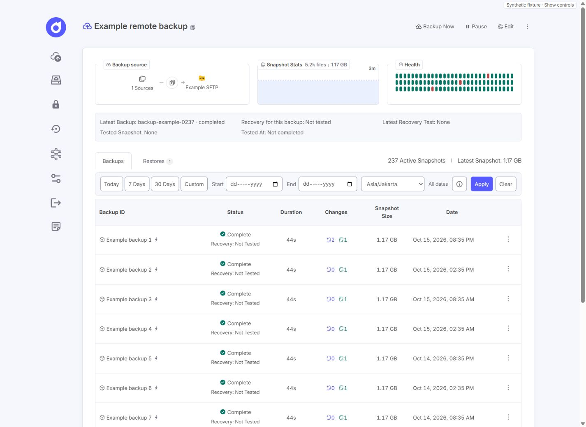
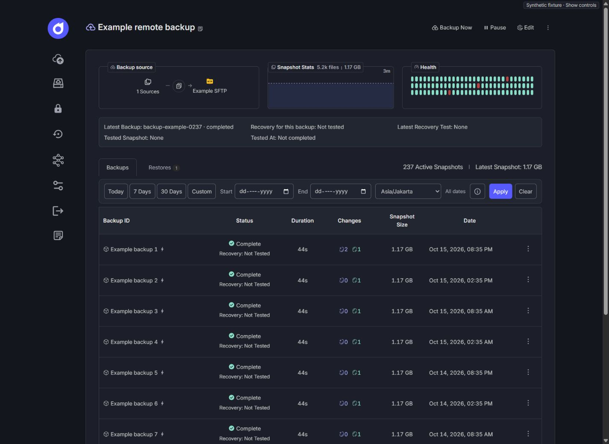
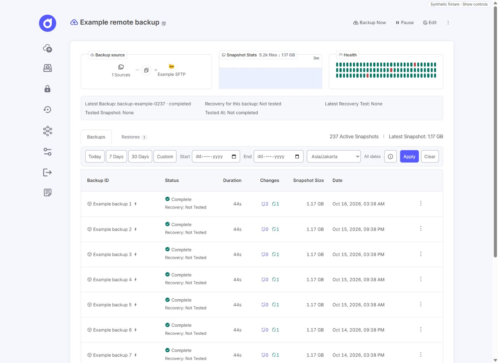
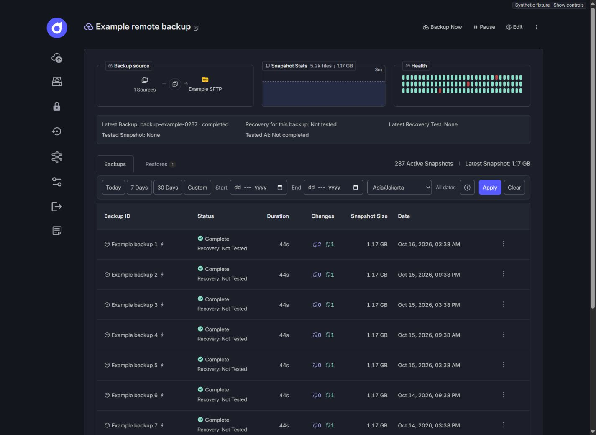
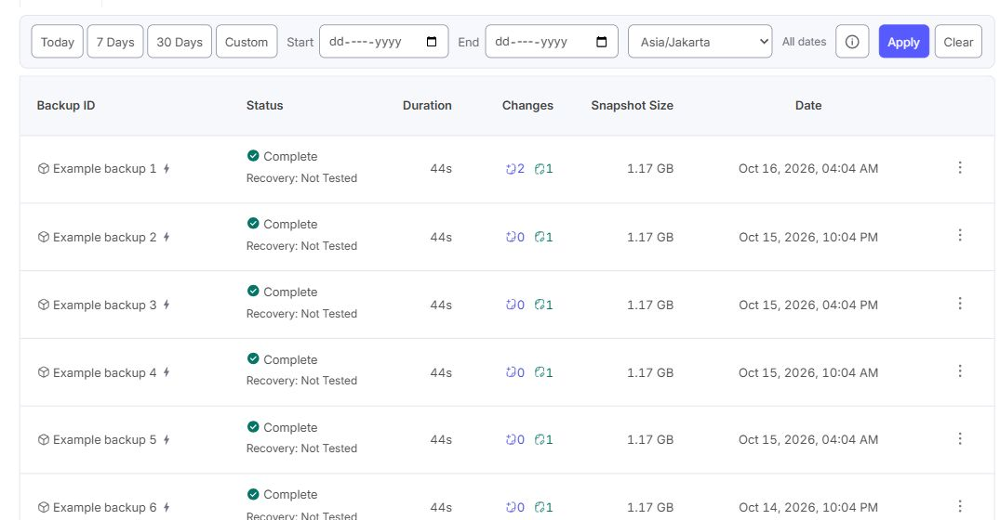

# Compact dashboard and Backup History row actions

Latest visual revision: [Centered Date and compact Actions](#centered-date-and-compact-actions).
Earlier measurements below are retained as history, not the final layout contract.

## Scope and evidence

Frontend presentation only, on `codex/compact-dashboard-row-actions`, based on
reviewed `main` `bd72311` (verified against the fork's current remote main).
No commit, push, merge, release, deployment, production access, or backup/restore
execution was performed. No dependency, API, migration, Agent, credential,
repository, or backup/recovery lifecycle change is required.

The working tree was clean before starting. Existing theme, filter, pagination,
snapshot associations, action availability and confirmation handlers are retained.

## Confirmed causes and changes

1. **Width:** `385c92c`, immediately before modernization `e8d8e3e` (merged by
   `bd72311`), defines `--container-width: 1200px`. Modernization changed that to
   `1560px` and desktop app gutters from 20px to 32px. Restore **1200px and 20px**,
   not an invented intermediate width. Keep the original 50px sidebar plus 40px
   sidebar/content gap. Retain `max-width: 100%`, `min-width: 0`, mobile 16px
   gutters/bottom-nav clearance, modern 32px top spacing (20px mobile), fonts,
   palette and theme persistence; do not restore the old viewport-relative 6%
   top spacing or revert the modernization commit.
2. **Action target:** the previous 36px column had 20px of cell padding, a 30×32px
   button and 12px artwork. The button did not fit its available inner width.
   Use shared heading/row grid tracks, a **64px desktop / 72px mobile** action
   column, 12px cell side padding, **38×38px / 44×44px** buttons and **18px** vertical
   three-dot artwork. Buttons are centered with about 13px/14px to the column
   edge. Theme-token hover, expanded and visible keyboard-focus states are explicit.
3. **Menu clipping/keyboard:** the old absolute popup was inside the scrollable
   table and had no Escape/outside/focus handling. There is no reusable application
   menu-positioning component; `react-tooltip` is for tooltips, not keyboard menus.
   Reuse the application's React portal overlay pattern, with a small pure,
   viewport-bounded placement helper. The menu flips upward when necessary,
   avoids the mobile nav, constrains tall contents, repositions on nested scroll
   and resize, and dismisses if its row scrolls out of view. Listeners, observers
   and animation-frame callbacks are removed on close/unmount. No DOM reparenting
   hacks or new library were introduced.
4. **Bindings:** the owning row still supplies all original action callbacks,
   disabled states, actual backup and snapshot IDs. The controlled open ID stays
   in `Backups`; the existing page/filter key unmounts stale menus. Native
   Enter/Space activation, menu/item names, arrow/Home/End navigation, Escape
   focus return, Tab dismissal and outside dismissal are covered.

The table's minimum tracks total 806px desktop / 814px mobile. Only the table
scrolls below that width, instead of enforcing the previous 900px table at every
viewport below 1150px. The Duration heading was visually checked and its 80px
track avoids splitting the word. No whole-document horizontal scrolling is needed.

## Actual A/B/C measurements

A uses the **actual historical frontend sources**, extracted read-only from
`385c92c` into ignored `tmp/compact-original`, not a CSS imitation. B was captured
from clean main before editing; C uses the proposed frontend. All use identical
synthetic API fixtures, never a live backend. A intentionally has the old unpaged
history; B/C retain the newer server-paged presentation.

CSS pixels below are rounded; the test browser has an approximately 15px vertical
scrollbar. Light and Dark gave the same geometry.

| Viewport | Shell A / B / C | Content A / B / C | Plan cards + filter C | Shell outer margin C (each, approx.) | Filter rows C |
| --- | --- | --- | --- | --- | --- |
| 1366 | 1200 / 1287.2 / 1200 | 1110 / 1197.2 / 1110 | 1048.4 | 75.6 | 1 |
| 1440 | 1200 / 1360.8 / 1200 | 1110 / 1270.8 / 1110 | 1048.4 | 112.4 | 1 |
| 1920 | 1200 / 1560 / 1200 | 1110 / 1470 / 1110 | 1048.4 | 352.4 | 1 |
| 1024 | 968.8 / 944.8 / 968.8 | 878.8 / 854.8 / 878.8 | 817.2 | 20 | 2 |
| 768 | 712.8 / 720.8 / 720.8 | 712.8 / 720.8 / 720.8 | 689.2 | 16 | 3 |
| 390 | 335.2 / 343.2 / 343.2 | 335.2 / 343.2 / 343.2 | 311.6 | 16 | 4 |

At 1440px, inner plan-card widths A/B/C are 1050 / 1209.2 / 1048.4px;
the original desktop proportions are restored. The 1.6px A/C difference is the
retained modern border treatment. Sidebar/content separation remains 40px.
Representative remote history row heights A/B/C are 76.6 / 72.9 / 72.9px: larger
hit targets do **not** make rows taller. In C, heading and row tracks were measured
identically: approximately `247.3, 194.3, 80, 141.3, 108, 212, 64px` at desktop.

The existing date toolbar already fits the restored width, so its component,
styles, date logic, API query and URL handling were **not changed**. Native date
inputs measure about 139/144px × 36px on compact desktop; at 1024px about
153/159px × 36px; mobile 139px × 42px. Calendar controls remain visible. All
presets, labels, zone, Applied/Pending, help, Apply and Clear remain available.

### Screenshots

Actual screenshots with synthetic infrastructure only. Complete six-width,
two-theme captures and measurement JSON were retained as local review artifacts
under `compact-dashboard-row-actions`; representative screenshots are included
with this report.

| State at 1440px | Light | Dark |
| --- | --- | --- |
| A: historical compact | [Original](assets/compact-dashboard/A-original-light-1440.jpg) | [Original](assets/compact-dashboard/A-original-dark-1440.jpg) |
| B: modern wide | [Before](assets/compact-dashboard/B-wide-light-1440.jpg) | [Before](assets/compact-dashboard/B-wide-dark-1440.jpg) |
| C: compact + new features | [After](assets/compact-dashboard/C-compact-light-1440.jpg) | [After](assets/compact-dashboard/C-compact-dark-1440.jpg) |

[390px layout](assets/compact-dashboard/C-compact-dark-390.jpg),
[desktop keyboard menu](assets/compact-dashboard/C-desktop-menu-dark.jpg),
[mobile last-row menu](assets/compact-dashboard/C-mobile-menu-light.jpg).

## Validation results

Node 24.16.0; repository-pinned pnpm 10.20.0; existing lockfile/dependencies.

| Check | Result |
| --- | --- |
| `node --experimental-strip-types --test frontend/__tests__/*.test.ts` | **127 passed, 0 failed, 0 skipped**; original 117 assertions/tests retained, 10 new focused tests |
| `node --experimental-strip-types --test frontend/__tests__/rowActionMenu.test.ts` | **10 passed, 0 failed** |
| `pnpm --filter @plutonhq/core-frontend exec tsc -b` | Passed |
| `pnpm --filter @plutonhq/core-frontend build` | Passed, including docs tests **12/12** and Fumadocs **8/8** |
| `pnpm --filter @plutonhq/core-frontend lint` | Existing baseline config failure, below |
| `git diff --check` | Passed |
| Backend/Agent tests | Not rerun: no backend/Agent code, protocol, query or lifecycle change |

New automated coverage checks the historical shell contract, centering/gutters,
mobile containment, shared columns, theme-token focus/hover, placement bounds at
all six widths, last-row/right-edge/tall-menu positioning, native trigger
semantics, unchanged disabled callbacks/IDs, menu keyboard/blur, scroll/offscreen
dismissal, and listener/observer cleanup. Existing date/pagination/action-availability,
theme/System, multi-DB, recovery, restore and notification frontend tests all pass.
CSS contract/unit tests are complemented by actual browser checks, not substituted
for rendered validation:

- **96 layout states**: Plans, Plan Detail, Sources, Source Detail, Storages,
  storage edit/detail panel, Repository List and Repository Detail × six widths
  (1366/1440/1920/1024/768/390) × Light/Dark. No measured document-level horizontal
  overflow. Sidebar/header/card proportions remain balanced; no page-specific
  width exceptions were needed. Storage detail is a side panel, not a separate
  route. Opening animations were allowed to settle before final panel inspection.
- Page sizes **10/20/50**, Next and correct current/last-row menu IDs verified.
  Changing page while a menu is open removes it; next-page actions name the
  newly returned backup, not a stale prior one.
- Native **Enter/Space**, first enabled item focus, End/arrow navigation,
  **Escape** return to the trigger and **Tab** dismissal verified in-browser.
  At a near-bottom desktop last row, the menu flipped up. At 390px, its right
  edge stayed within the viewport after table-only horizontal scrolling and its
  bottom stayed above the fixed nav. Actual mobile target/column: 44px/72px.
- Last 7 Days produced the applied inclusive range. Editing the zone showed
  Pending without changing matching rows until Apply; Apply displayed UTC
  timestamps and recalculated the synthetic range; Today and Clear worked.
  Draft/Custom, invalid ranges, URL preservation/back navigation and IANA date
  boundaries remain covered by the unchanged history tests.
- Reviewed screenshots and browser error/warning logs; no runtime errors observed.
  No Backup Now, restore, import, recovery-test or storage-update submission ran.

**Existing lint limitation:** ESLint 10.0.0 / typescript-eslint 8.56.0 rejects the
string `eslint-config-prettier` in `frontend/eslint.config.js`'s `extends` array
(index 5). It fails before analyzing source. That baseline config and dependency
versions are untouched; lint is not reported as passing. Non-fatal existing build
warnings remain for Fumadocs `::highlight`, browser externalization of
`node:fs/promises`, large chunks, and stale Browserslist data.

## Changed files and rollback

- `frontend/src/styles/global.scss`
- `frontend/src/components/App/App/App.module.scss`
- `frontend/src/components/Plan/Backups/Backups.tsx`
- `frontend/src/components/Plan/Backups/Backups.module.scss`
- `frontend/src/components/Plan/Backups/BackupRowMenu.tsx` (new)
- `frontend/src/components/Plan/Backups/BackupRowMenu.module.scss` (new)
- `frontend/src/utils/rowActionMenu.ts` (new)
- `frontend/__tests__/rowActionMenu.test.ts` (new)
- `frontend/__tests__/theme-preview/app.tsx` (synthetic repository fixtures)
- `frontend/__tests__/theme-preview/server.mjs` (optional historical preview)
- This report and nine synthetic screenshots in `docs/assets/compact-dashboard/`.

To reproduce A locally, extract only `frontend/src` from `385c92c` into ignored
`tmp/compact-original`, then run the existing preview server from `frontend` with
`--original` (loopback port 5189); normal preview uses 5188. Both use mocked APIs;
the historical backend, production data and secrets are never loaded. Screenshots
are rendered browser evidence, not production end-to-end acceptance. Native date
control visuals on other OS/browser engines remain a manual acceptance item.

For a future reviewed rollout, build the frontend with the existing process and
check compact page proportions, dates and a last-row menu with an authorized
session. No data migration, new setting or Agent update is needed. If rollback is
required, restore the previous frontend/application artifact through the existing
reviewed process; keep `/data`, SQLite, SECRET/ENCRYPTION_KEY, agent identities,
plans and repositories unchanged. No deployment or rollback was executed here.

## Backup History Table Column Alignment

This follow-up continues on the same branch and supersedes the initial table
distribution above. The approved dashboard, cards, date toolbar, pagination,
themes and action-button/menu implementation are unchanged. Earlier uncommitted
branch work was preserved. The only production source edited in this follow-up
is `frontend/src/components/Plan/Backups/Backups.module.scss`.

### Root cause and focused fix

Actual DOM measurements confirmed the fractional grid enlarged ID, status and
changes to 247/194/141px. Centered status labels increased the perceived ID/status
gap. Date values were left-aligned, but their heading was centered. The final
64px track ended at the table edge, leaving the action target only about 14px
inward. These were table rules, not a dashboard or filter-toolbar problem.

Use one shared, bounded seven-track definition for header and every row. Cap
the main tracks, distribute spare room as equal small gaps across the group,
and reserve 8px/24px left/right grid gutters. Do not move all spare width into
one column. ID/status/date align left; duration, changes and size align right
under their headings; action targets remain centered. Snapshot Size now fits
one line. Preserve its old heading envelope with `calc(3em + 24px)` on header
cells, so the requested horizontal refinement does not change vertical density.
ID wrapping remains available; no ellipsis, clipping, font reduction or identity
change was introduced. There are no per-row content-dependent track positions.

### Measured before/after at 1440px

Both themes produced the same CSS-pixel measurements:

| Track | Before | After |
| --- | ---: | ---: |
| Backup ID | 247.26 | 220 |
| Status | 194.29 | 156 |
| Duration | 80 | 80 |
| Changes | 141.30 | 104 |
| Snapshot Size | 108 | 124 |
| Date | 211.95 | 220 |
| Actions | 64 | 80 |

The capped tracks total 984px, with approximately 5.13px between each adjacent
pair and 32px total outer grid padding. This balances the whole group rather
than widening a single leftover-space track.

| Actual DOM anchor / dimension | Before | After |
| --- | ---: | ---: |
| Backup ID content left | 244 | 252 |
| Status heading text left | 558.45 | 477.13 |
| Duration value right | 727.33 | 698.25 |
| Changes content right | 853.63 | 807.38 |
| Snapshot Size value right | 976.03 | 936.50 |
| Date value left | 1014.85 | 961.63 |
| Date heading text left | 1096.46 | 961.63 |
| Action button left | 1229.80 | 1197.75 |
| Action button distance from table right | 13.80 | 45.85 |
| Table width | 1048.40 | 1048.40 |
| Header height | 63.80 | 63.80 |
| Representative completed-row height | 72.90 | 72.90 |
| Desktop action target | 38 × 38 | 38 × 38 |
| Document overflow | 0 | 0 |

ID-to-Status heading-anchor separation decreases from 314.45px to 225.13px.
The row status now starts at the same left content anchor as its heading,
instead of centering the label inside an enlarged track. Date moves inward
53.22px; actions move inward 32.05px. Numeric heading/value right edges match.

### Before/after screenshots

The existing synthetic preview was used without changing its fixtures or
application logic. Full six-width/two-theme before/after captures and DOM
measurements are retained locally under `backup-history-columns`.

| Theme | Before | After |
| --- | --- | --- |
| Light, 1440px | [Before](assets/compact-dashboard/columns-before-light-1440.jpg) | [After](assets/compact-dashboard/columns-after-light-1440.jpg) |
| Dark, 1440px | [Before](assets/compact-dashboard/columns-before-dark-1440.jpg) | [After](assets/compact-dashboard/columns-after-dark-1440.jpg) |

[390px last-row menu](assets/compact-dashboard/columns-after-mobile-menu-dark.jpg).

### Responsive and functional verification

- All **12 after states** (1366/1440/1920/1024/768/390 × Light/Dark) were measured
  against their captured before states. Header and every displayed row share
  identical column positions/widths. Every sampled row height, including the
  final row, is unchanged; header stays 63.8px. No document overflow was observed.
- Shell position/width, summary-card geometry and the complete date-toolbar
  rectangle match before exactly at all six widths. SHA-256 comparison confirms
  all nine inspected approved shell/filter/pagination/menu source/style files
  are byte-for-byte unchanged. Pagination control dimensions/alignment are also
  unchanged. The approved 1200px maximum width and sidebar spacing are untouched.
- Desktop tracks are 220/156/80/104/124/220/80px at 1366, 1440 and 1920px.
  Constrained containers use 160/148/80/90/124/156/64px plus 24px grid padding;
  mobile uses a 72px action column instead. **38px/44px hit targets are unchanged.**
- **Responsive limitation/trade-off:** table-only horizontal scrolling remains
  necessary. Its minimum content width is now 846px (854px mobile), versus
  806/814px before, to retain a readable single-line size heading and inward
  action spacing. At 1024px a native horizontal scrollbar adds about 15.2px to
  the table's flow height and therefore moves pagination down by that amount;
  it does not alter row heights or pagination styles. No global width was changed.
  Mobile users still scroll the table to reach rightmost columns; dates wrap
  naturally where necessary rather than being truncated.
- Page sizes **10/20/50**, last-row Space opening, next-page menu identity,
  Enter, arrow navigation and Escape focus return were rechecked. No stale
  menu survives paging. At 390px the last-row menu remains a body portal inside
  viewport bounds and above the fixed nav, with a measured 44px trigger.
- Last 7 Days, draft UTC selection, Pending without application, Apply and Clear
  still work. Existing URL, inclusive-date, actual backup/snapshot binding,
  availability/permission and System-theme tests continue to pass. No backup,
  restore, recovery-test or import was executed; this is synthetic UI evidence,
  not production workflow acceptance. Browser error/warning logs were empty.

### Follow-up tests and changed files

| Check | Result |
| --- | --- |
| Full frontend suite | **133 passed, 0 failed, 0 skipped**: prior 127 retained + 6 new layout tests |
| Row action + column layout suites | **16 passed, 0 failed** |
| Frontend TypeScript check | Passed |
| Frontend production build | Passed, including docs **12/12** and Fumadocs **8/8** |
| `git diff --check` | Passed |
| Frontend lint | Same pre-existing ESLint/`eslint-config-prettier` configuration failure described above; not a pass |

The existing row-menu layout test was strengthened to assert the new bounded
desktop distribution and both constrained distributions, not removed or skipped.
New layout tests verify shared tracks, gap allocation, minimum-width arithmetic,
heading/value anchors, unchanged vertical envelope, non-truncation and protected
button/shell/filter dimensions. No dependency or backend tests were needed for
this stylesheet-only production change.

Follow-up file changes only:

- `frontend/src/components/Plan/Backups/Backups.module.scss`
- `frontend/__tests__/rowActionMenu.test.ts` (updated layout contract)
- `frontend/__tests__/backupHistoryColumns.test.ts` (six new tests)
- This report and five `columns-*.jpg` synthetic screenshots.

No JSX, API, backend, Agent, Restic, schema, deployment, permission, credential,
snapshot-association or menu-positioning code was changed. No commit, push,
merge, release, deployment or production access was performed.

## Centered Date and compact Actions

This latest, user-requested refinement supersedes the preceding left-aligned Date
and inward Actions layout. Inspection confirmed that Date explicitly used left
alignment, while the desktop action track reserved 80px plus a 24px right gutter.
That allocated excessive space to a single three-dot button.

Both the Date heading and timestamps now center on the same shared column axis.
Actions reserves only 56px on desktop/constrained layouts and 60px on mobile,
with 8px cell padding and an 8px outer gutter. The **38px/44px click targets are
unchanged**. Reclaimed desktop width goes to the bounded Date track, not enlarged
gaps or the first five columns. Dates still wrap instead of being truncated.

| Measured at 1440px, both themes | Previous revision | Latest revision |
| --- | ---: | ---: |
| Date track | 220px, left-aligned | 260px, centered |
| Actions track | 80px | 56px |
| Right grid gutter | 24px | 8px |
| Button inset from table right | 45.85px | 17.85px |
| Header height | 63.80px | 63.80px |
| Completed row height | 72.90px | 72.90px |

The first five tracks and their horizontal positions are exactly unchanged at
1440px, as are all ten row heights, the full date-toolbar rectangle, and pagination
geometry. All nine previously protected shell/filter/pagination/menu files retain
the same SHA-256 hashes. Narrow table minima are reduced from 846/854px to
830/834px; horizontal scrolling stays inside the table. The container fallback
threshold now matches the revised desktop minimum of 898px.

Verification used the synthetic preview at **1366/1440/1920/1024/768/390px in both
Light and Dark**. All 12 states have aligned header/row tracks, centered Date
heading/value text (under 0.01px center difference), unchanged click targets, and
no document overflow. Mobile last-row menu opening, arrow navigation, Escape
focus return, 20-row paging and stale-menu dismissal were checked. Returning to
10 rows restores the original toolbar/table/pagination geometry. No browser
errors or warnings were observed. This is local UI verification, not production
backup/recovery acceptance.

[Full Light view](assets/compact-dashboard/date-actions-refined-light-1440.jpg),
[full Dark view](assets/compact-dashboard/date-actions-refined-dark-1440.jpg),
[mobile menu](assets/compact-dashboard/date-actions-refined-mobile-menu-dark.jpg).

Validation rerun:

- `node --experimental-strip-types --test frontend/__tests__/*.test.ts`: **133 passed, 0 failed, 0 skipped**.
- Focused row-menu/column tests: **16 passed**, including centered heading/value
  alignment, compact action tracks, gutter arithmetic and preserved hit targets.
- `pnpm --filter @plutonhq/core-frontend exec tsc -b`: passed.
- `pnpm --filter @plutonhq/core-frontend build`: passed; docs **12/12**, Fumadocs
  **8/8**. Existing chunk/CSS/browser-data warnings remain non-fatal.
- `pnpm --filter @plutonhq/core-frontend lint`: still blocked by the pre-existing
  ESLint configuration incompatibility (`eslint-config-prettier` string in
  `tseslint.config`); not a lint pass and not modified by this task.
- `git diff --check`: passed.

This revision changes only `Backups.module.scss`, layout expectations in
`backupHistoryColumns.test.ts` and `rowActionMenu.test.ts`, this report and four
synthetic screenshots. Existing uncommitted branch work is preserved. No JSX,
business logic, backend, Agent, data, credentials or deployment changes. No
commit or push was performed.
